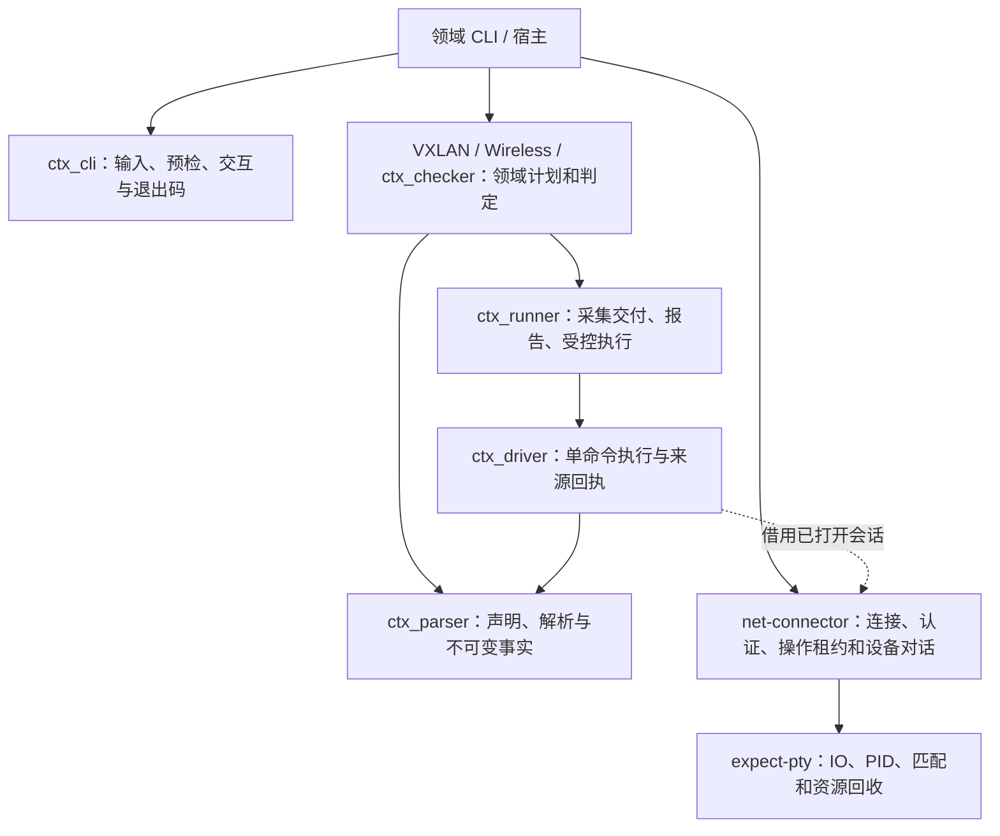
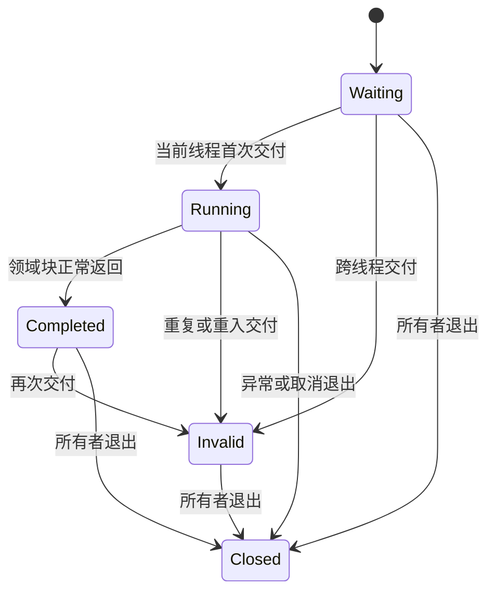

# 网络模块的业务边界与原子操作

本设计覆盖 ctx_parser、ctx_driver、ctx_runner、ctx_cli、ctx_checker、net-connector、expect-pty、VXLAN 和 Wireless。目录 `expect-ruby` 对应 gem expect-pty，`wireless-rb` 对应 Ruby 命名空间 Wireless。相邻 worktree 可能包含不同工作，不能当作同一版本。

## 业务链路与依赖

实线表示业务组合或依赖方向；Driver 的原生适配只操作已加载连接器提供的会话，不自动 require、打开或重连。ctx_cli 不依赖 Runner 或具体领域，通过显式 adapter 和 batch 协作者完成终端编排。net-connector 的 CLI 使用 ctx_cli；底层 PTY 不反向依赖业务库。

| 模块 | 独立职责 | 交付物或接口 | 资源所有权 |
| --- | --- | --- | --- |
| expect-pty | 进程创建、字节匹配、超时、脱敏、关闭回收 | Session、Result、ResourceOwner | 拥有创建的 IO/PID；借用日志目标 |
| net-connector | 认证、提示符、厂商对话、操作互斥、命令步骤 | 原生 Session、Result、Command | 拥有连接及操作租约；关闭底层资源 |
| ctx_driver | 校验单条查询、执行回执、正文和原始摘要分离 | Reader、Capture、可选 Session 适配 | 借用会话；首次失同步后停止后续命令 |
| ctx_parser | 文本来源、命令声明、共享视图、事实快照 | Commands、Profile、Result、Immutable | 不持有连接或宿主状态 |
| ctx_runner | 唯一会话交付、单查询、批量结果、证据发布和已确认变更 | SessionScope、Collection、Query、Batch、Report、Execution | 借用会话；报告对象拥有自己的文件 |
| ctx_cli | 来源配置、输入预算、静态预览、预检顺序、交互和退出码 | Configuration、Collection、Review、Apply、Output | 借用标准流；调度任务须由宿主回收 |
| ctx_checker | 配置适用性、有限发现、观测关联、健康和计数策略 | Collector、Applicability、Snapshot、Evaluator | 借用连接器；规则独立于传输 |
| VXLAN | 配置依赖、Fabric 范围、服务身份、ACL 和类型化增量 | CollectionPlan、Collector、Fabric::Review、ChangePlan | 领域连接适配器取得操作租约 |
| Wireless | 控制器查询、AP 身份和选择、邻居覆盖、模板增量 | Collector、ApCollection、ApSession、Projection、ChangePlan | ApCollection 借用控制器；ApSession 管理转接租约 |

## 原子操作的含义

原子边界由可独立核验的业务事实决定，不能把一次跨设备网络操作当成本地事务。

1. **请求预检**：完整校验设备身份、维度、凭据与资源限制后再打开连接。身份和选择范围在任何时钟、连接器、凭据回调前复制。
2. **会话交付**：每次 Collection 或 Execution 只能在创建它的线程内接受一次同步交付。零交付、重复、跨线程或未正常完成都不能成为成功。
3. **单命令 Capture**：一条查询对应一个回执；原始字节摘要与解码正文分别保存。失败不重放；失同步后的查询标记 skipped。
4. **单来源多视图**：共享命令读取、解析一次，各视图独立投影。单个视图失败不抹除其他视图或其他来源。
5. **单 AP 邻居采集**：AP 清单决定选择范围；无匹配不读取凭据。每个 AP 独立保留尝试状态、摘要、邻居数和失败阶段，部分覆盖不能刷新未采集 AP 的覆盖时间。
6. **单设备报告交付**：先登记设备事实，再持久化报告。保存失败不能删除设备已经完成的结果；文件原子替换与目录同步分别记账。
7. **单项确认变更**：先保存意图，回读配置并比对指纹，逐条记录 pending/acknowledged，最后回读验证。发送后失败为 uncertain，不自动回滚或重试。
8. **批次完成**：调度器回收全部工作后，再计算交付状态并发布摘要。终端展示失败只补写状态，不能再次连接设备。

## 统一会话作用域

`SessionScope` 只维护一次交付资格、完成事实和撤销状态，不持有会话对象、连接器、业务回调或凭据。短临界区保护资格变更，领域操作在锁外执行。`close` 只撤销回调资格，不关闭设备连接。

交付失败状态保留到流程结束，即使连接器 rescue 了回调异常，也不能恢复为完成。作用域结束后的回调直接抛出 IOError，且不修改已经发布的结果。

| 事实 | Collection | Execution |
| --- | --- | --- |
| 没有交付 | session_not_opened | failed；不发命令 |
| 重复交付 | session_reentered；保留首次事实 | 已发送则 uncertain；不重放 |
| 交付块未完成但异常被提供方吞掉 | session_incomplete，关闭失败不覆盖它 | failed/uncertain，取决于是否开始发送 |
| 跨线程交付 | session_out_of_scope；不调用领域块 | failed；不发命令 |
| 关闭连接失败 | session_close_failed；保留已完成事实和先前交付故障 | 不发布 configuration_verified |

线程池应在每个设备任务内部创建 Collection/Execution 并同步打开、使用、关闭该设备的会话。并行发生在设备任务之间，不能将已借出的会话回调移交给后台线程。

## Wireless 的领域拆分

`Collector` 保留控制器请求预检、依赖维度展开、终端准备、共享查询和最终 Snapshot。`ApCollection` 接收不可变 access_points 观测、借用控制器会话、选择名称、延迟凭据源与 AP 会话工厂，输出一个 LLDP Observation。

ApCollection 负责 AP 选择、缺失名称、覆盖范围、回执归属及逐 AP 失败隔离；`ApSession` 继续负责登录/返回控制器和嵌套操作租约。厂商 Profile 和 NeighborParser 继续维护命令及语法。公共 Runner 不承担 AP、型号、Fabric 或健康策略。

`Wireless::Collector#collect` 使用公共身份白名单和快照，返回结构按 schema 3 迁移。新的领域对象可以单独使用，但必须显式提供 `Wireless::Observation(name: :access_points)`；选择范围在回调前快照，非法输入在访问凭据前拒绝。

## 本次落地与验证边界

- Collection 和 Execution 共用 SessionScope，移除两份交付状态逻辑；补全吞异常、跨线程、重复交付及非局部退出的行为测试。
- Wireless 的 AP 邻居业务从 Collector 提取到 ApCollection，保留原有来源和诊断语义，并增加独立入口的输入边界测试。
- VXLAN、ctx_checker 经现有 Collection 自动使用统一约束；ctx_parser、ctx_driver、ctx_cli、net-connector、expect-pty 保持其当前职责，不增加反向依赖。
- 包括原生适配和 PTY 的链路需要用本地合成会话验证；网络设备兼容性仍需对应型号实机验证。源码联调与隔离 gem 安装是不同验收项。

后续改动仍应以具体业务不变量为依据：发现策略留在 ctx_checker，配置依赖留在 VXLAN，AP 选择和租约留在 Wireless；不要因类名相似而合并这些策略，也不要新增统一工作流 DSL。对底层资源所有权的修改必须覆盖取消、关闭失败和已完成设备效果的保留。

本次验证结果、环境限制与复现证据见 [2026-10-25 验证记录](verification-2026-10-25.md)。

2026-10-29 的值对象、快照、apply 和文件格式契约见 [契约迁移](contracts-2026-10-29.md)。
